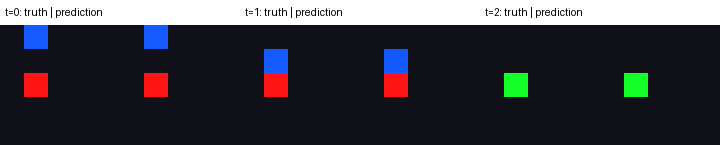

# Проверка mini-WAM, 1 ноября 2026

> История прежнего самостоятельного CNN baseline. Эти результаты не относятся к новому серверному конвейеру NanoWM + XLand `trivial-1m`. Его инструкции и статус: [SERVER_PLAN_RU.md](../docs/SERVER_PLAN_RU.md).

Выполнены настоящие обучения и взаимодействия со средой на CPU, macOS, Python 3.11.17, torch 2.7.1, numpy 1.26.4. Это самостоятельный компактный CNN WAM baseline. CUDA и удалённый сервер здесь не проверялись.

## Одно действие: полная серия

Конфигурация: [one_step.json](../configs/one_step.json). PPO: seed 42; WAM: seed 3407. Все три режима и n = 1, 2, 3 обучены. Эксперт получил **100% train / validation / test SR**. Для каждого режима итоговый test — полный набор из **16 отложенных задач**, цели не совпадают с train/validation.

| Режим | n=1 | n=2 | n=3 |
|---|---:|---:|---:|
| policy | 16/16, 100% | 16/16, 100% | 16/16, 100% |
| video | 16/16, 100% | 16/16, 100% | 16/16, 100% |
| joint | 16/16, 100% | 16/16, 100% | 16/16, 100% |

Это closed-loop SR в настоящей среде. На одношаговом эпизоде только первый future target валиден: n=2/3 проверяет работу масок и интерфейса, а не обучение дополнительным реальным шагам.

Артефакты: [таблица](one_step/summary.md), [полный JSON](one_step/summary.json), [проверка данных](one_step/dataset/audit.json), [конфигурация со всеми defaults](one_step/resolved_config.json). Кривые обучения и оценки каждой модели находятся в `one_step/models/`.

## Два действия: проверенный пилот

Конфигурация: [two_step_smoke.json](../configs/two_step_smoke.json). Отдельно обучены эксперт, новый датасет и три WAM при n=3. Действительно валидны два будущих кадра/действия. Эксперт — **100% SR**, каждый режим — **24/24 отложенных задачи, 100% SR**.

| Режим | Test SR | Точность клеток объектов на mixed dataset |
|---|---:|---:|
| policy | 100% | — |
| video | 100% | 97,74% |
| joint | 100% | 98,49% |

Артефакты: [таблица](two_step/summary.md), [JSON](two_step/summary.json), [аудит](two_step/dataset/audit.json). Полная двухшаговая серия n={1,2,3} подготовлена в [two_step.json](../configs/two_step.json); локально выполнен именно пилот n=3.

В каждой паре слева реальный кадр, справа прогноз `joint` по записанным действиям. Последний зелёный кадр означает достижение цели. Прогноз может ошибаться в пикселях, сохраняя правильное первое действие.

## Почему SR сначала был ниже 100%

Отдельно сохранён недостаточно обученный `video`: тот же двухшаговый датасет, seed, архитектура и планировщик, но только **50 updates**. Проверка на **validation**, без подбора по test:

| Показатель | После 50 updates |
|---|---:|
| SR | 5/23 = 21,74% |
| Общая точность клеток | 95,54% |
| Точность клеток объектов | 56,03% |
| Ошибки со столкновением с границей | 11 |
| Остальные неверные направления | 7 |
| Forecast MSE | 0,01447 |
| Копирование исходного кадра, MSE | 0,02559 |

Например, для задачи `0,1 → 0,3` агент дважды выбрал `up` и упёрся в верхнюю границу вместо двух ходов вправо. Высокая общая pixel accuracy и даже выигрыш у копирования контекста не означают, что модель правильно предсказывает движение редкого объекта. Изображения дают планировщику ошибочную оценку действий.

При продолжении обучения на том же датасете `video` достиг validation SR **100% уже на 250 updates**. PPO и replay-аудит были корректны; планировщик с идеальной визуальной динамикой решает весь конечный банк в тесте. Эти проверки указывают на недостаточное обучение визуальной динамики в раннем checkpoint. Это не доказывает, что любая будущая ошибка объясняется только бюджетом обучения.

Сохранены [все 18 failure traces и offline metrics](underfit_video/validation/evaluation.json), [кривая короткого запуска](underfit_video/metrics.json) и [кривая полного пилота](two_step/models/video_n3_seed3407/metrics.json). `behavior_sr` датасета ниже экспертного SR, потому что в него намеренно включены случайные/контрфактические действия; неудачные эпизоды не удалялись.

## Технические проверки

- 13 тестов: среда, границы эпизодов и GAE, маски loss, отсутствие утечки кадров, выравнивание переходов, достижимость, визуальный планировщик, экспорт.
- Для PPO и WAM имитировано прерывание после атомарного checkpoint. Продолженное обучение совпало с непрерывным по весам, optimizer, RNG и истории метрик.
- `compileall` и `bash -n scripts/train_server.sh` прошли.
- Чистая экспортированная папка прошла Git staging: исходники обоих upstream присутствуют, gitlinks отсутствуют. Editable package/CLI проверены с уже установленными pinned dependencies.
- После основной серии ускорено чтение NPZ при replay-аудите: каждый массив распаковывается один раз. Результат повторного аудита совпал с сохранённым, тесты повторно прошли. Новый сквозной smoke после изменения получил SR 100% во всех трёх режимах: [итоговый JSON](final_smoke/summary.json).

Конфигурации, manifest/checksums, кривые, оценки и небольшие GIF/forecast NPZ включены в этот каталог. Обученные веса и полные новые datasets находятся в локальном `runs/`, исключены из Git и в чистой копии создаются заново. [Машиночитаемые проверки](checks.json).

100% здесь означает отсутствие ошибок на конкретном конечном held-out bank. Проверка новых split/training seeds, больших полей, препятствий и настоящих многошаговых задач — отдельные эксперименты. Random baseline в JSON использует один seeded rollout на задачу; это не точное математическое ожидание случайной политики.
